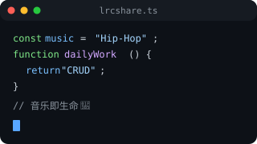

# 你好呀，我是 X2 👋

关于名字 X2：一个人总觉得孤单，乘以二就成了幸福的事；X2 也是棉花糖乐团的一首歌，推荐大家去听听；另外初中时同学常叫我「熊二」（跟《熊出没》无关），再加上我姓熊，算是熊猫的远房亲戚 🐼

## 我是一个 Java 程序员

- 👨‍💻 目前从事后端开发，日常 CRUD 工程师
- 📚 纯纯摆烂中 😅
- 💪🏼 希望可以赚更多的钱
- ⚡ 音乐就是我的生命，什么都听，主要喜欢 Hip-Hop / 粤语歌

 

---

### 🛠 主要维护的项目

[LrcShare](https://lrcshare.com) — 一个开源歌词库

---

### 📈 GitHub Statistics

  
  

---

### 🔗 我的社交账号

- ▶️ YouTube：[@xmy0329](https://www.youtube.com/@xmy0329)
- 📺 哔哩哔哩：[@37977624](https://space.bilibili.com/37977624)
